<p align="center">
  
</p>

<p align="center">
  
  
  
  
  
</p>

<p align="center">
  <a href="#overview"><b>Overview</b></a> ·
  <a href="#quick-start"><b>Quick Start</b></a> ·
  <a href="#version-compatibility"><b>Compatibility</b></a> ·
  <a href="#configuration"><b>Configuration</b></a> ·
  <a href="#troubleshooting"><b>Troubleshooting</b></a> ·
  <a href="#changelog"><b>Changelog</b></a>
</p>

---

## Overview

The Smart-1 Cloud Spark Gateway Deployer automates the onboarding of Check Point Quantum Spark
gateways to Check Point Smart-1 Cloud. From a single set of configuration files, it registers each
gateway, configures the gateway object, installs the security policy and, optionally, configures
the appliance itself.

| Capability | Description |
|---|---|
| **Bulk registration** | Registers any number of gateways in Smart-1 Cloud and retrieves their MaaS tokens. |
| **Object configuration** | Sets the version, operating system, Spark hardware and SIC trust settings through the Management API. |
| **Policy installation** | Installs the Access Control and Threat Prevention policy on every gateway that was configured. |
| **Appliance configuration** | Optionally connects each appliance to Smart-1 Cloud over its local REST API. Supports Zero Touch appliances. |
| **Version awareness** | Detects the Smart-1 Cloud management version and adapts SIC configuration to it, including R82.20. |
| **Validation and logging** | Validates all configuration files before the run and keeps a rotating DEBUG log of every run. |

### Architecture

<p align="center">
  
</p>

### Workflow

<p align="center">
  
</p>

A gateway that fails in phase 1 is logged and skipped, and the run continues with the remaining
gateways. Policy installation in phase 2 runs only for the gateways that were configured.

## Quick Start

```bash
git clone https://github.com/alshawwaf/smart1_cloud_sparks_deployer.git
cd smart1_cloud_sparks_deployer
python -m venv .venv
```

Activate the virtual environment and install the dependencies:

| Windows | Linux |
|---|---|
| `.venv\Scripts\activate` | `source .venv/bin/activate` |

```bash
pip install -r requirements.txt
```

Create the three files described in [Configuration](#configuration), then run:

```bash
python s1c_deploy_sparks_gw.py
```

### Requirements

- A Check Point Smart-1 Cloud tenant.
- Infinity Portal API credentials (Client ID and Access Key), created in the Infinity Portal.
- A Management API key, created in the Smart-1 Cloud application.
- Python 3.9 or later on Windows or Linux.
- Optional: network access to the local REST API of each Spark appliance. Not required for
  appliances onboarded with Zero Touch.

## Version Compatibility

The deployer detects the Smart-1 Cloud management version at run time and adapts the SIC
configuration to it. No configuration change is required when Smart-1 Cloud is upgraded. The
detected version is shown for each gateway:

```text
INFO - Connected to Management API version 2.1
```

### Smart-1 Cloud Management

| Smart-1 Cloud | Management API | SIC configuration |
|:---:|:---:|---|
| **R82.20** | 2.1 | One-time password set after the object is converted to a Spark gateway, with `trust-settings.initiation-phase` set to `when_gateway_connects`. |
| **R82.10** | 2.0.1 | One-time password set after the object is converted to a Spark gateway. |
| **R82** | 2.0 | One-time password set after the object is converted to a Spark gateway. |

> [!IMPORTANT]
> **Smart-1 Cloud R82.20 requires the current version of the deployer.**
> R82.20 added the `trust-method` and `trust-settings` parameters to `set-simple-gateway`. When a
> one-time password is set on an object that is not yet a Spark gateway, the management server
> pushes the SIC certificate immediately. Spark appliances behind Smart-1 Cloud cannot be reached
> in this way, so earlier versions of the deployer fail at the SIC step.

<p align="center">
  
</p>

### Spark Gateway Firmware

| Firmware on the appliance | Smart-1 Cloud R82.20 | `version` in `config_data.json` |
|:---:|:---:|:---:|
| **R82.00.X** | Supported | `R82` |
| **R81.10.X** | Supported | `R81.10` |
| R80.20.X and earlier | Not supported | Upgrade the appliance first |

> [!WARNING]
> Rugged 1200R appliances are not supported by Smart-1 Cloud R82.20.

> [!TIP]
> To list the versions and hardware models that your tenant accepts, run the Management API
> command `show-gateway-capabilities` with `{"platform": "smb"}`, for example from the
> SmartConsole command line.

## Configuration

The deployer reads three JSON files from the `config` directory.

```text
config/
├── auth_data.json             Smart-1 Cloud and Infinity Portal credentials
├── config_data.json           One entry for each gateway
└── policy_package_data.json   Policy package to install
```

> [!NOTE]
> JSON does not support comments. Each file must contain only the keys described below.

### `config/auth_data.json`

```json
{
    "client_id": "your-client-id",
    "access_key": "your-access-key",
    "portal_url": "https://cloudinfra-gw-us.portal.checkpoint.com",
    "instance": "your-instance",
    "context": "your-context-uuid",
    "api_key": "your-management-api-key"
}
```

| Key | Description |
|---|---|
| `client_id` | Infinity Portal API Client ID. |
| `access_key` | Infinity Portal API Access Key. |
| `portal_url` | Infinity Portal API gateway for your region, for example `https://cloudinfra-gw-us.portal.checkpoint.com`. |
| `instance` | Smart-1 Cloud instance name, taken from the Management API URL `https://<instance>.maas.checkpoint.com/<context>/web_api`. |
| `context` | Smart-1 Cloud context ID, taken from the same URL. |
| `api_key` | Management API key created in the Smart-1 Cloud application. |

### `config/config_data.json`

```json
[
    {
        "gw_name": "sparks1",
        "version": "R81.10",
        "hardware": "1575/1595",
        "net_type": "Wireless",
        "sic_key": "your-sic-key",
        "gateway_ip": "203.0.113.171:4434",
        "gateway_username": "admin",
        "gateway_password": "secure-password"
    },
    {
        "gw_name": "sparks2",
        "version": "R82",
        "hardware": "1800",
        "net_type": "Wireless",
        "sic_key": "your-sic-key"
    }
]
```

| Key | Required | Description |
|---|:---:|---|
| `gw_name` | Yes | Gateway name, used for the Smart-1 Cloud registration and the gateway object. |
| `version` | Yes | Firmware family of the appliance. See [Spark Gateway Firmware](#spark-gateway-firmware). |
| `hardware` | Yes | Spark appliance model family as shown in SmartConsole, for example `1575/1595` or `1800`. |
| `net_type` | Yes | Appliance variant, for example `Wired` or `Wireless`. |
| `sic_key` | Yes | One-time password used to establish SIC. |
| `gateway_ip` | No | Address and port of the appliance local REST API, for example `203.0.113.171:4434`. |
| `gateway_username` | No | Administrator user name on the appliance. |
| `gateway_password` | No | Administrator password on the appliance. |

To have the deployer configure the appliance in phase 3, provide all three of `gateway_ip`,
`gateway_username` and `gateway_password`. Omit them for appliances onboarded with Zero Touch.

### `config/policy_package_data.json`

```json
{
    "policy_package": "Standard",
    "install_delay": 30
}
```

| Key | Description |
|---|---|
| `policy_package` | Name of the policy package to install on the gateways. |
| `install_delay` | Reserved. Not used by the current version of the deployer. |

## Logging

| Output | Level | Content |
|---|:---:|---|
| Console | INFO | Progress of each phase and gateway. |
| `logs/s1c_deploy_sparks_gw.log` | DEBUG | Full details, including API responses. Rotated at 5 MB, with 3 backups. |

**Resilience**

- Infinity Portal API requests are retried up to 3 times.
- All configuration files are validated before the deployment starts.
- After registration, the deployer waits up to 3 minutes for Smart-1 Cloud to create the gateway
  object.
- Each phase opens and closes its own Management API session.

## Troubleshooting

| Symptom | Cause | Resolution |
|---|---|---|
| SIC errors on `set-simple-gateway`, or the gateway does not reach the "communicating" state, after the upgrade to R82.20 | Earlier versions of the deployer set the one-time password before the object was a Spark gateway | Update to the current version and confirm that the log shows `Management API version 2.1`. |
| `Policy installation failed` with a session error | Earlier versions of the deployer used a closed Management API session | Update to the current version. |
| `Gateway object ... not created yet` repeats and then fails | Smart-1 Cloud did not create the gateway object within 3 minutes | Confirm that the gateway is listed in the Smart-1 Cloud application in the Infinity Portal, then run the deployer again. |
| `Management server upgrade in progress` warning | Smart-1 Cloud is running a background upgrade | Wait for the upgrade to complete, then run the deployment. |
| The gateway is rejected or is not listed | Firmware earlier than R81.10.X, or a Rugged 1200R appliance | See [Version Compatibility](#version-compatibility). |

For full details of a run, see `logs/s1c_deploy_sparks_gw.log`.

## Security

> [!CAUTION]
> The configuration files contain credentials. Do not commit them to version control. Add
> `config/*.json` to `.gitignore`.

- The local REST API client does not verify the appliance certificate. Run phase 3 only on
  trusted management networks.
- Use a dedicated Management API key for the deployer and revoke it when it is no longer needed.

## References

| Resource | Link |
|---|---|
| Smart-1 Cloud API Reference | [SwaggerHub](https://app.swaggerhub.com/apis-docs/Check-Point/smart-1_cloud_api/1.0.0#/) |
| Check Point Management API Reference | [sc1.checkpoint.com](https://sc1.checkpoint.com/documents/latest/APIs/) |
| R82.20 Release Notes | [PDF](https://sc1.checkpoint.com/documents/R82.20/WebAdminGuides/EN/CP_R82.20_RN/CP_R82.20_ReleaseNotes.pdf) |

## Changelog

### November 2026: Smart-1 Cloud R82.20 support

- SIC is configured after the gateway object is converted to a Spark gateway. On R82.20
  (Management API 2.1), the deployer also sets `trust-settings.initiation-phase` to
  `when_gateway_connects`, so the appliance pulls its certificate.
- Policy installation opens its own Management API session, and the logout request is sent
  correctly.
- The deployer waits for Smart-1 Cloud to create the gateway object instead of relying only on a
  fixed delay.
- The management SIC name is parsed regardless of field order or case.
- Policy installation is skipped when no gateway was configured.
- A task that partially succeeds is reported as a failure.
- Fixed `delete_gateway()` in `utils/smart1_cloud_api.py`.
- Console and log messages no longer contain emojis.
