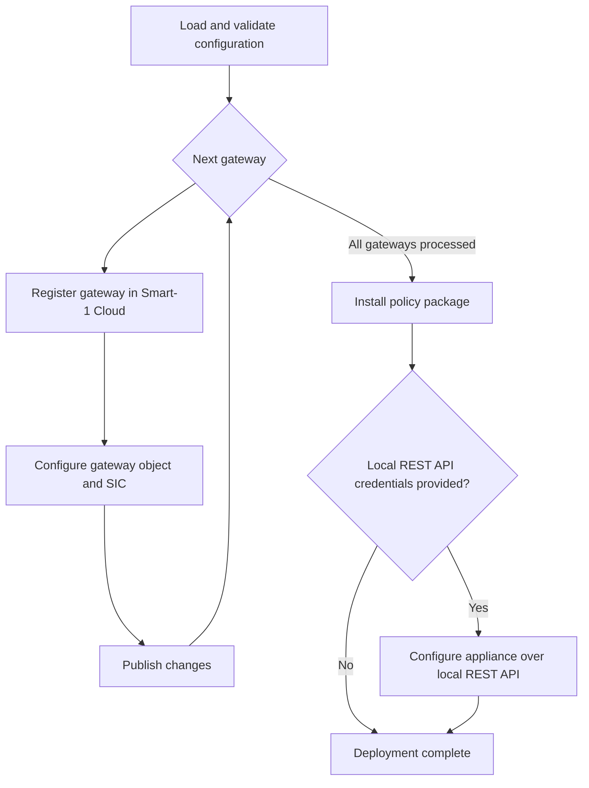

# Smart-1 Cloud Spark Gateway Deployer

Automates the onboarding of Check Point Quantum Spark gateways to Check Point Smart-1 Cloud:
gateway registration, gateway object configuration, policy installation and, optionally,
configuration of the appliance itself over its local REST API.

## Contents

- [How It Works](#how-it-works)
- [Requirements](#requirements)
- [Version Compatibility](#version-compatibility)
- [Installation](#installation)
- [Configuration](#configuration)
- [Usage](#usage)
- [Logging](#logging)
- [Troubleshooting](#troubleshooting)
- [Security](#security)
- [References](#references)
- [Changelog](#changelog)

## How It Works

The script runs in three phases:

1. **Registration and object configuration** (for each gateway in `config_data.json`)
   - Registers the gateway in Smart-1 Cloud through the Infinity Portal API and stores the
     returned Smart-1 Cloud (MaaS) token.
   - Configures the gateway object through the Management API: version, operating system,
     Spark appliance type and hardware, and SIC (trust) settings.
   - Publishes the changes.
2. **Policy installation**
   - Installs the configured policy package (Access Control and Threat Prevention) on all
     gateways that were configured successfully.
3. **Appliance configuration** (optional)
   - For gateways that have local REST API credentials, runs the Gaia Clish commands that connect
     the appliance to Smart-1 Cloud, initialize SIC and fetch the policy.
   - Gateways without credentials are expected to be onboarded with Zero Touch.



## Requirements

- A Check Point Smart-1 Cloud tenant.
- Infinity Portal API credentials (Client ID and Access Key), created in the Infinity Portal.
- A Management API key, created in the Smart-1 Cloud application.
- Python 3.9 or later.
- Optional: network access to the local REST API of each Spark appliance. Not required when
  appliances are onboarded with Zero Touch.

## Version Compatibility

The script detects the Smart-1 Cloud management version at run time and adjusts how it configures
SIC for each gateway. No configuration change is required when Smart-1 Cloud is upgraded. The
detected version is shown at the start of each gateway configuration:

```text
INFO - Connected to Management API version 2.1
```

### Smart-1 Cloud Management

| Smart-1 Cloud version | Management API | SIC configuration |
|---|---|---|
| R82.20 | 2.1 | The one-time password is set after the object is converted to a Spark gateway, with `trust-settings.initiation-phase` set to `when_gateway_connects`. The appliance pulls its certificate. |
| R82, R82.10 | 2.0, 2.0.1 | The one-time password is set after the object is converted to a Spark gateway. The R82.20 trust settings are not sent, because these versions do not support them. |

**Note on R82.20:** R82.20 added the `trust-method` and `trust-settings` parameters to the
`set-simple-gateway` command. If a one-time password is set on an object that is not yet a Spark
gateway, the management server tries to push the SIC certificate to the gateway immediately.
Spark gateways behind Smart-1 Cloud cannot be reached in this way, so earlier versions of this
script fail at the SIC step on R82.20. Use the current version of the script with R82.20.

### Spark Gateway Firmware

| Firmware on the appliance | Supported by Smart-1 Cloud R82.20 | `version` value in `config_data.json` |
|---|---|---|
| R81.10.X | Yes | `R81.10` |
| R82.00.X | Yes | `R82` |
| R80.20.X and earlier | No | Upgrade the appliance first |

- Rugged 1200R appliances are not supported by R82.20 management.
- The `version` value must match the firmware family that runs on the appliance.
- To list the versions and hardware models that your tenant accepts, run the Management API
  command `show-gateway-capabilities` with `{"platform": "smb"}`, for example from the
  SmartConsole command line.

## Installation

Windows:

```powershell
git clone https://github.com/alshawwaf/smart1_cloud_sparks_deployer.git
cd smart1_cloud_sparks_deployer
python -m venv .venv
.venv\Scripts\activate
pip install -r requirements.txt
```

Linux:

```bash
git clone https://github.com/alshawwaf/smart1_cloud_sparks_deployer.git
cd smart1_cloud_sparks_deployer
python3 -m venv .venv
source .venv/bin/activate
pip install -r requirements.txt
```

## Configuration

The script reads three JSON files from the `config` directory. JSON does not support comments,
so the files must contain only the keys described below.

### config/auth_data.json

```json
{
    "client_id": "your-client-id",
    "access_key": "your-access-key",
    "portal_url": "https://cloudinfra-gw-us.portal.checkpoint.com",
    "instance": "your-instance",
    "context": "your-context-uuid",
    "api_key": "your-management-api-key"
}
```

| Key | Description |
|---|---|
| `client_id` | Infinity Portal API Client ID. |
| `access_key` | Infinity Portal API Access Key. |
| `portal_url` | Infinity Portal API gateway for your region, for example `https://cloudinfra-gw-us.portal.checkpoint.com`. |
| `instance` | Smart-1 Cloud instance name. The first part of the Management API URL: `https://<instance>.maas.checkpoint.com/<context>/web_api`. |
| `context` | Smart-1 Cloud context ID. The path segment that follows the host name in the Management API URL. |
| `api_key` | Management API key created in the Smart-1 Cloud application. |

### config/config_data.json

One entry for each gateway:

```json
[
    {
        "gw_name": "sparks1",
        "version": "R81.10",
        "hardware": "1575/1595",
        "net_type": "Wireless",
        "sic_key": "your-sic-key",
        "gateway_ip": "203.0.113.171:4434",
        "gateway_username": "admin",
        "gateway_password": "secure-password"
    },
    {
        "gw_name": "sparks2",
        "version": "R82",
        "hardware": "1800",
        "net_type": "Wireless",
        "sic_key": "your-sic-key"
    }
]
```

| Key | Required | Description |
|---|---|---|
| `gw_name` | Yes | Gateway name. Used for the Smart-1 Cloud registration and the gateway object. |
| `version` | Yes | Firmware family of the appliance. See [Spark Gateway Firmware](#spark-gateway-firmware). |
| `hardware` | Yes | Spark appliance model family as shown in SmartConsole, for example `1575/1595` or `1800`. |
| `net_type` | Yes | Appliance variant, for example `Wired` or `Wireless`. |
| `sic_key` | Yes | One-time password used to establish SIC. |
| `gateway_ip` | No | Address and port of the appliance local REST API, for example `203.0.113.171:4434`. |
| `gateway_username` | No | Administrator user name for the appliance. |
| `gateway_password` | No | Administrator password for the appliance. |

To have the script configure the appliance (phase 3), provide all three of `gateway_ip`,
`gateway_username` and `gateway_password`. Omit them for appliances onboarded with Zero Touch.

### config/policy_package_data.json

```json
{
    "policy_package": "Standard",
    "install_delay": 30
}
```

| Key | Description |
|---|---|
| `policy_package` | Name of the policy package to install on the gateways. |
| `install_delay` | Reserved. Not used by the current version of the script. |

## Usage

Run the script from the repository root with the virtual environment activated.

Windows:

```powershell
python s1c_deploy_sparks_gw.py
```

Linux:

```bash
python3 s1c_deploy_sparks_gw.py
```

The console shows the progress of each phase: registration and configuration of each gateway,
the publish and policy installation tasks, and the commands sent to each appliance. A gateway that
fails is logged and skipped, and the script continues with the remaining gateways. Policy
installation runs only for gateways that were configured successfully.

## Logging

| Output | Level | Details |
|---|---|---|
| Console | INFO | Progress of each phase. |
| `logs/s1c_deploy_sparks_gw.log` | DEBUG | Full details, including API responses. Rotated at 5 MB, 3 backups kept. |

Error handling:

- Infinity Portal API requests are retried up to 3 times.
- All configuration files are validated before the deployment starts.
- After registration, the script waits up to 3 minutes for Smart-1 Cloud to create the gateway
  object.
- Each phase opens and closes its own Management API session.

## Troubleshooting

| Symptom | Cause | Resolution |
|---|---|---|
| SIC errors on `set-simple-gateway`, or the gateway does not reach the "communicating" state, after the Smart-1 Cloud upgrade to R82.20 | Earlier versions of the script set the one-time password before the object was a Spark gateway, so R82.20 tried to push the certificate | Use the current version of the script and confirm that the log shows `Management API version 2.1`. |
| `Policy installation failed` with a session error | Earlier versions of the script used a closed Management API session for policy installation | Use the current version of the script. |
| `Gateway object ... not created yet` repeats and then fails | Smart-1 Cloud did not create the gateway object within 3 minutes | Confirm that the gateway is listed in the Smart-1 Cloud application in the Infinity Portal, then run the script again. |
| `Management server upgrade in progress` warning | Smart-1 Cloud is running a background upgrade | Wait for the upgrade to complete, then run the deployment. |
| The gateway is rejected or is not listed | Firmware earlier than R81.10.X, or a Rugged 1200R appliance | See [Version Compatibility](#version-compatibility). |

For full details of a run, see `logs/s1c_deploy_sparks_gw.log`.

## Security

- The configuration files contain credentials. Do not commit them to version control; add
  `config/*.json` to `.gitignore`.
- The local REST API client does not verify the appliance certificate. Run phase 3 only on trusted
  management networks.

## References

- [Smart-1 Cloud API Reference](https://app.swaggerhub.com/apis-docs/Check-Point/smart-1_cloud_api/1.0.0#/)
- [Check Point Management API Reference](https://sc1.checkpoint.com/documents/latest/APIs/)
- [R82.20 Release Notes](https://sc1.checkpoint.com/documents/R82.20/WebAdminGuides/EN/CP_R82.20_RN/CP_R82.20_ReleaseNotes.pdf)

## Changelog

### November 2026: Smart-1 Cloud R82.20 support

- SIC is configured after the gateway object is converted to a Spark gateway. On R82.20
  (Management API 2.1), the script also sets `trust-settings.initiation-phase` to
  `when_gateway_connects`, so the appliance pulls its certificate.
- Policy installation opens its own Management API session, and the logout request is sent
  correctly.
- The script waits for Smart-1 Cloud to create the gateway object instead of relying only on a
  fixed delay.
- The management SIC name is parsed regardless of field order or case.
- Policy installation is skipped when no gateway was configured.
- A task that partially succeeds is reported as a failure.
- Fixed `delete_gateway()` in `utils/smart1_cloud_api.py`.
