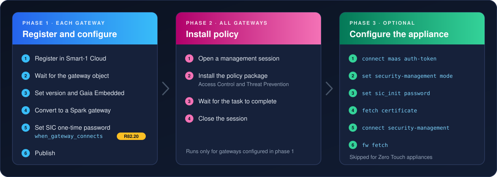

# Smart-1 Cloud Spark Gateway Deployer

Automated onboarding of Check Point Quantum Spark gateways to Smart-1 Cloud.


[Overview](#overview) · [Quick Start](#quick-start) · [Configuration](#configuration) · [Documentation](#documentation)

---

## Overview

The Smart-1 Cloud Spark Gateway Deployer automates the onboarding of Check Point Quantum Spark
gateways to Check Point Smart-1 Cloud. From a single set of configuration files, it registers each
gateway, configures the gateway object, installs the security policy and, optionally, configures
the appliance itself.

| Capability | Description |
|:---|:---|
| **Registration** | Registers any number of gateways in Smart-1 Cloud with only a Management API key. |
| **Object configuration** | Creates the Spark gateway object with the parameters documented in the Smart-1 Cloud Administration Guide, after checking them against the tenant, sets the SIC trust settings and enables the blades configured for the gateway. |
| **Policy installation** | Waits for each gateway to establish SIC, then installs the policy package: first the Access Control policy, then the Threat Prevention policy on gateways where IPS, Anti-Bot or Anti-Virus is enabled. |
| **Appliance configuration** | Connects each appliance to Smart-1 Cloud over its local REST API, when its credentials are configured. Otherwise, saves the cloud token and the onboarding steps to a local file for manual onboarding. |
| **Removal** | Returns the appliances to local management and deletes their gateway objects (`--delete`). |
| **Validation and logging** | Validates all configuration files before the run and keeps a rotating DEBUG log of every run. |

### Architecture

<p align="center">
  
</p>

### Workflow

<p align="center">
  
</p>

1. **Register and configure.** Each gateway object is created in Smart-1 Cloud with a cloud token,
   the SIC one-time password and the blades configured for it.
2. **Configure the appliance.** With appliance credentials, the deployer connects the appliance
   over its local REST API. Without them, it saves the cloud token and the onboarding steps to
   `tokens/<gw_name>.txt` for [Manual Onboarding](#manual-onboarding).
3. **Install policy.** The deployer waits for SIC, sets the interfaces of the gateway object from
   the appliance, then installs the Access Control policy and the Threat Prevention policy.

A gateway that fails at any step is logged and skipped, and the run ends with a summary of each
gateway. [How the Deployer Works](docs/HOW_IT_WORKS.md) explains each phase, the registration
calls, the interface handling and what happens when a step fails.

## Quick Start

Clone the repository, install the dependencies and create your configuration files from the
templates.

**Windows (PowerShell)**

```powershell
git clone https://github.com/alshawwaf/smart1_cloud_sparks_deployer.git
cd smart1_cloud_sparks_deployer
python -m venv .venv
.venv\Scripts\activate
pip install -r requirements.txt
copy config\auth_data.example.json config\auth_data.json
copy config\config_data.example.json config\config_data.json
copy config\policy_package_data.example.json config\policy_package_data.json
```

**Linux**

```bash
git clone https://github.com/alshawwaf/smart1_cloud_sparks_deployer.git
cd smart1_cloud_sparks_deployer
python3 -m venv .venv
source .venv/bin/activate
pip install -r requirements.txt
cp config/auth_data.example.json config/auth_data.json
cp config/config_data.example.json config/config_data.json
cp config/policy_package_data.example.json config/policy_package_data.json
```

Fill in the three files as described in [Configuration](#configuration), then run the deployment:

```bash
python s1c_deploy_sparks_gw.py
```

The run ends with a summary of each gateway. See [Live Deployment Example](docs/LIVE_EXAMPLE.md#live-deployment-example)
for the output of a real run.

To remove the gateways in `config_data.json` again, run:

```bash
python s1c_deploy_sparks_gw.py --delete
```

For each gateway, `--delete`:

1. Returns the appliance to local management, when its REST API credentials are configured:
   `set maas mode disable`, `fw sic_reset`, `set security-management mode locally-managed`,
   and checks the result with `show security-management`.
2. Deletes the gateway object in Smart-1 Cloud, including its membership in groups such as
   `Playblocks_Gateways`, and publishes.

If the appliance reset fails, the gateway object is still deleted and the gateway is reported as
failed in the removal summary. A gateway that no longer exists in Smart-1 Cloud is skipped, so
`--delete` can be run again safely. After `--delete`, the appliance can be deployed again from
scratch. For a gateway without appliance credentials, `--delete` deletes the object and its token
file, and the appliance must be reset manually.

### Manual Onboarding

To onboard an appliance yourself, for example when the machine that runs the deployer cannot reach
it, leave out `gateway_ip`, `gateway_username` and `gateway_password` for that gateway. The
deployer then:

1. Registers and configures the gateway object as usual.
2. Saves `tokens/<gw_name>.txt` with the cloud token, its expiration date, and the onboarding
   steps for the Spark WebUI and for Gaia Clish, taken from the
   [Smart-1 Cloud Administration Guide](https://sc1.checkpoint.com/documents/Infinity_Portal/WebAdminGuides/EN/Check-Point-SmartCloud-Admin-Guide/CP_Check_Point_Smart-1_Cloud_AdminGuide.pdf) (Connecting a Spark Firewall
   Appliance). The file names the management server address for `fetch certificate`.
3. Reports the gateway as `registered, token saved for manual onboarding`. This does not count as
   a failure.

The SIC one-time password is not written to the file. Use the `sic_key` value from
`config_data.json`. After the appliance is connected, install the policy on it from SmartConsole.

> [!CAUTION]
> The token file contains a credential. `tokens/` is excluded by `.gitignore`. Delete the file
> after the appliance is connected.

### Requirements

- A Check Point Smart-1 Cloud tenant on R82.20 (Management API 2.1 or later).
- The Management API key of the tenant. In Web SmartConsole, go to **Settings > API &
  SmartConsole** and click **Generate** in the Management API section. Smart-1 Cloud supports only
  one API key.
- Python 3.9 or later on Windows or Linux.
- To configure the appliances (phase 2) and reset them with `--delete`:
  - Network access to the appliance local REST API, by default on port `4434`.
  - The REST API enabled on the appliance. It is off by default. Enable it in Gaia Clish with
    `set rest-api mode true`.

### Network Requirements

All connections are outbound. No inbound access and no public IP address are needed, and
Smart-1 Cloud never connects to the appliance local REST API.

| From | To | Port | Carries |
|:---|:---|:---:|:---|
| Machine that runs the deployer | `<instance>.maas.checkpoint.com` (Management API) | 443 | Management API key, gateway settings, SIC one-time password |
| Machine that runs the deployer | Appliance local REST API (`gateway_ip`, for example a private lab address) | 4434 | Appliance administrator credentials, cloud token, SIC one-time password. Phase 2 and `--delete` only. |
| Appliance | `<instance>.maas.checkpoint.com` and the regional `cloudinfra-gw` address | 443 | Outbound tunnel to Smart-1 Cloud. Management traffic, SIC and policy installation run inside this tunnel. |

If the appliance or the machine that runs the deployer is behind another firewall, allow this
outbound HTTPS traffic. The [Smart-1 Cloud Administration Guide](https://sc1.checkpoint.com/documents/Infinity_Portal/WebAdminGuides/EN/Check-Point-SmartCloud-Admin-Guide/CP_Check_Point_Smart-1_Cloud_AdminGuide.pdf) lists the
addresses for each region (How to Connect a Security Gateway Behind a NAT/Proxy or Third-Party
Security Gateway). Run phase 2 from a machine on a trusted network that can reach the appliances,
because the deployer does not verify the appliance certificate.

> [!WARNING]
> The deployer installs the policy package exactly as it is published. Before you run it, make
> sure the policy allows the management access you need to the appliances, for example HTTPS and
> SSH from your administration network. A cleanup rule that drops all traffic locks you out of
> the appliance local interfaces as soon as the policy is installed.

## Configuration

The deployer reads three JSON files from the `config` directory. The repository contains a
template for each file. Your own files are excluded by `.gitignore`, so credentials are never
committed.

```text
config/
├── auth_data.example.json             Template: Smart-1 Cloud credentials
├── config_data.example.json           Template: one entry for each gateway
├── policy_package_data.example.json   Template: policy package and timeouts
├── auth_data.json                     Your file (not tracked)
├── config_data.json                   Your file (not tracked)
└── policy_package_data.json           Your file (not tracked)
```

> [!NOTE]
> JSON does not support comments, so do not add `//` notes to the files. Keys that are not
> described below are ignored.

> [!IMPORTANT]
> **Upgrading from an earlier version:** the configuration files were previously tracked in the
> repository and are now excluded. Copy your `config` folder to a safe location before you run
> `git pull`, then copy your three files back into `config/`. If `git pull` reports local changes
> to the configuration files, run `git checkout -- config` after the backup and pull again.
> Earlier versions used Infinity Portal API keys (`client_id`, `access_key`, `portal_url`) in
> `auth_data.json`. They are no longer used and can be removed.

### `config/auth_data.json`

```json
{
    "instance": "your-instance",
    "context": "your-context-uuid",
    "api_key": "your-management-api-key"
}
```

| Key | Required | Description |
|:---|:---:|:---|
| `instance` |  | Smart-1 Cloud instance name, taken from the Management API URL `https://<instance>.maas.checkpoint.com/<context>/web_api`. Web SmartConsole shows this URL in **Settings > API & SmartConsole**. |
| `context` |  | Smart-1 Cloud context ID, taken from the same URL. |
| `api_key` |  | Management API key of the tenant, generated in Web SmartConsole in **Settings > API & SmartConsole**. |

### `config/config_data.json`

```json
[
    {
        "gw_name": "sparks1",
        "version": "R81.10",
        "hardware": "1575/1595",
        "net_type": "Wireless",
        "sic_key": "your-sic-key",
        "gateway_ip": "203.0.113.171:4434",
        "gateway_username": "admin",
        "gateway_password": "your-appliance-password",
        "vpn": true,
        "ips": true,
        "anti_bot": true,
        "anti_virus": true,
        "application_control": true,
        "url_filtering": true
    },
    {
        "gw_name": "sparks2",
        "version": "R82",
        "hardware": "1800",
        "net_type": "Wired",
        "sic_key": "your-sic-key"
    }
]
```

| Key | Required | Description |
|:---|:---:|:---|
| `gw_name` |  | Gateway name, used for the Smart-1 Cloud registration and the gateway object. |
| `version` |  | Firmware family of the appliance, as accepted by the tenant: `R81.10` or `R82`. See [Spark Gateway Firmware](docs/COMPATIBILITY.md#spark-gateway-firmware). |
| `hardware` |  | Spark model as listed by `show-gateway-capabilities`, for example `1800 Appliances` or `1575/1595 Appliances`. The short form without "Appliances", for example `1800`, is also accepted. |
| `net_type` |  | Appliance variant, not case-sensitive: `Wired`, `Wireless`, `Wireless + DSL` or `WiFi-LTE`. Each model accepts only some of them, for example a 2560/2570 with Wi-Fi uses `WiFi-LTE`, not `Wireless`. See [net_type values by model](docs/COMPATIBILITY.md#net_type-values-by-model). |
| `sic_key` |  | One-time password used to establish SIC. |
| `gateway_ip` |  | Address and port of the appliance local REST API, for example `203.0.113.171:4434`. |
| `gateway_username` |  | Administrator user name on the appliance. |
| `gateway_password` |  | Administrator password on the appliance. |
| `vpn` |  | Enable the IPsec VPN blade. Default `false`. |
| `ips` |  | Enable the IPS blade. Default `false`. |
| `anti_bot` |  | Enable the Anti-Bot blade. Default `false`. |
| `anti_virus` |  | Enable the Anti-Virus blade. Default `false`. |
| `application_control` |  | Enable the Application Control blade. Default `false`. |
| `url_filtering` |  | Enable the URL Filtering blade. Default `false`. |

The Firewall blade is always enabled. Every other blade is off unless its key is set to `true`
for that gateway, so a gateway without blade keys is created with the Firewall blade only. In the
example above, `sparks1` gets all six blades and `sparks2` gets the Firewall blade only. The
console shows the result for each gateway:

```text
INFO - Configured sparks1 successfully. Blades: firewall, vpn, ips, anti-bot, anti-virus, application-control, url-filtering
```

With `vpn` enabled, the Access Control installation reports the warning *"Gateway ... has an
empty Encryption Domain"* until you define the VPN domain of the gateway in SmartConsole. The
installation still succeeds. The policy package needs a Threat Prevention policy when `ips`,
`anti_bot` or `anti_virus` is enabled.

> [!NOTE]
> In the test tenant, which uses Playblocks, new gateways were added to the `Playblocks_Gateways`
> group shortly after they were deployed. The Quarantine Policy rules for that group require
> Application Control and URL Filtering. If this happens in your tenant, set both to `true` for
> those gateways, otherwise later policy installations fail with *"Rule 2 contains applications ... that require the 'Application
> Control' or the 'URL Filtering' blades"*.

To have the deployer configure the appliance in phase 2 and reset it with `--delete`, provide all
three of `gateway_ip`, `gateway_username` and `gateway_password`. Without them, the cloud token is
saved for [Manual Onboarding](#manual-onboarding). The deployer waits for SIC and installs policy
only for gateways that have all three, so remove them from every gateway that you onboard
yourself. At the start of a run, the console lists which gateways are in each group.

### `config/policy_package_data.json`

```json
{
    "policy_package": "Standard",
    "install_delay": 30,
    "sic_timeout": 600
}
```

| Key | Required | Description |
|:---|:---:|:---|
| `policy_package` |  | Name of the policy package to install on the gateways. |
| `sic_timeout` |  | Seconds to wait for gateways to establish SIC before policy installation. Default `600`. |
| `install_delay` |  | Reserved. Not used by the current version of the deployer. |

## Logging

| Output | Level | Content |
|:---|:---:|:---|
| **Console** | `INFO` | Progress of each phase and gateway. |
| **`logs/s1c_deploy_sparks_gw.log`** | `DEBUG` | Full details, including API responses. Rotated at 5 MB, with 3 backups. |

MaaS tokens, SIC one-time passwords and appliance passwords are replaced with `********` in the
console and in the log file.

## Security

> [!CAUTION]
> The configuration files contain credentials. They are excluded by `.gitignore`; do not force-add
> them to version control.

- Token files in `tokens/` contain the cloud token of a gateway. Delete them after the appliance
  is connected. `--delete` also deletes them.
- Secrets are masked in the console and the log file. Treat the log file as sensitive anyway,
  because it contains API responses.
- The local REST API client does not verify the appliance certificate. Run phase 2 only on
  trusted management networks.
- Smart-1 Cloud supports only one Management API key, and the deployer uses it. Protect it like an
  administrator password.

## Documentation

| Document | Content |
|:---|:---|
| **[How the Deployer Works](docs/HOW_IT_WORKS.md)** | The three phases in detail, gateway registration, interfaces and topology, resilience |
| **[Version Compatibility](docs/COMPATIBILITY.md)** | Smart-1 Cloud and Spark firmware versions, `net_type` values by model, tested environment |
| **[Live Deployment Example](docs/LIVE_EXAMPLE.md)** | Console output, timings and results of a real deployment and removal |
| **[Troubleshooting](docs/TROUBLESHOOTING.md)** | Causes and resolutions for each known error |
| **[Changelog](CHANGELOG.md)** | Changes by release |

## References

The deployer and this README were checked against these documents:

| Resource | Edition | Used for |
|:---|:---|:---|
| **[Smart-1 Cloud Administration Guide](https://sc1.checkpoint.com/documents/Infinity_Portal/WebAdminGuides/EN/Check-Point-SmartCloud-Admin-Guide/CP_Check_Point_Smart-1_Cloud_AdminGuide.pdf)** | 26 October 2026 | Adding a Spark gateway with the Web API, cloud token, supported Spark models and versions, MaaS commands, API key |
| **[Quantum Spark R81.10.X CLI Reference Guide](https://sc1.checkpoint.com/documents/SMB_R81.10.X/CLI/EN/CP_R81.10.X_1500_1600_1800_1900_2000_Appliances_CLI_Guide.pdf)** | 5 October 2026 | `connect maas`, `set maas mode`, `set security-management mode`, `set sic_init`, `fetch certificate`, `fw sic_reset`, `set rest-api` |
| **[Quantum Spark R82.00.X Centrally Managed Administration Guide](https://sc1.checkpoint.com/documents/Appliances/Quantum_Spark_R82.00.X/AdminGuides_Centrally_Managed/EN/CP_R82.00.X_Quantum_Spark_Appliances_Centrally_Managed_AdminGuide.pdf)** | 22 September 2026 | Smart-1 Cloud onboarding of R82.00.X appliances |
| **[Check Point Management API Reference](https://sc1.checkpoint.com/documents/latest/APIs/)** | v2.1 | `add-simple-gateway`, `set-simple-gateway` (including `trust-settings`), `show-gateway-capabilities`, `test-sic-status`, `delete-simple-gateway`, `install-policy` |
| **[R82.20 Release Notes](https://sc1.checkpoint.com/documents/R82.20/WebAdminGuides/EN/CP_R82.20_RN/CP_R82.20_ReleaseNotes.pdf)** | R82.20 | Supported Spark versions, Rugged 1200R |
