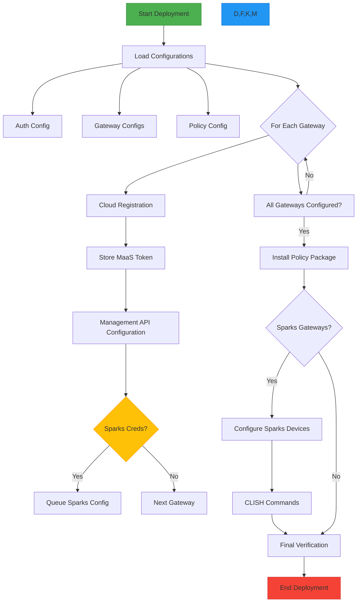

# Smart-1 Cloud Gateway Deployment Orchestrator

Automated deployment and configuration system for Check Point Smart-1 Cloud gateways with physical device integration.

## Features
- Automated gateway registration in Smart-1 Cloud
- Centralized management configuration
- Policy package deployment
- Physical gateway provisioning
- logging and error handling
- Configuration validation with Pydantic models
- Retry logic for API operations

## Prerequisites
- Check Point Smart-1 Cloud account.
- Valid API credentials (client ID/access key -> Generated from the Check Point Infinity Portal
- Management API key -> Generated from the Smart-1 Cloud application
- Python 3.9+
- Physical gateways with REST API access (Optional. Use ZeroTouch instead)

## Version Compatibility

The script detects the Smart-1 Cloud management version automatically and adjusts how it
configures SIC (trust) for each gateway. You do not need to change any setting when Smart-1
Cloud is upgraded. The detected version is printed at the start of every run:

```
INFO - Connected to Management API version 2.1
```

### Smart-1 Cloud management version

| Smart-1 Cloud version | Management API | What the script does |
|---|---|---|
| R82.20 | 2.1 | Sets the one-time password **after** the object is a Spark gateway, with `trust-settings: {"initiation-phase": "when_gateway_connects"}`. The Spark gateway pulls its certificate itself (`fetch certificate`). |
| R82 / R82.10 | 2.0 / 2.0.1 | Sets the one-time password **after** the object is a Spark gateway (the R82.20 trust settings are not sent, because these versions do not accept them). |

> **Why this matters (R82.20):** R82.20 added `trust-method` / `trust-settings` to
> `set-simple-gateway`. When a one-time password is set on an object that is not yet a Spark
> gateway, R82.20 tries to push the SIC certificate to the gateway immediately. Spark gateways
> behind Smart-1 Cloud cannot be reached that way, so deployments that worked before the
> upgrade started failing at the SIC step. Use this version of the script (or later) with R82.20.

### Spark gateway version (`version` in `config_data.json`)

| Spark firmware on the appliance | Supported by Smart-1 Cloud R82.20 | `version` value |
|---|---|---|
| R81.10.X | Yes | `"R81.10"` |
| R82.00.X | Yes | `"R82"` |
| R80.20.X and older | No | Upgrade the appliance first |

Notes:
- **Rugged 1200R appliances are not supported** by R82.20 management.
- `version` must match the firmware family running on the appliance.
- If you are unsure which values your tenant accepts, run the Management API command
  `show-gateway-capabilities` with `{"platform": "smb"}` (for example from the SmartConsole CLI).
  It lists the supported versions and hardware.

### Hardware (`hardware`) and network type (`net_type`)

- `hardware` is the Spark appliance model family, as shown in the gateway object in SmartConsole,
  for example `"1575/1595"` or `"1800"`.
- `net_type` is the appliance variant, for example `"Wired"` or `"Wireless"`.

## Installation

```bash
# Clone repository
git clone https://github.com/alshawwaf/smart1_cloud_sparks_deployer.git
cd smart1_cloud_sparks_deployer

# Create virtual environment
python.exe -m venv .venv

# Create virtual environment (Linux)
python3 -m venv .venv

# Activate environment (Windows)
.venv\Scripts\activate

# Activate environment (Linux)
source .venv/bin/activate

# Install dependencies
pip install -r requirements.txt
```

## Configuration
1. Create config directory
2. Add configuration files"

- config/auth_data.json

```json
{
    "client_id": "your-client-id",
    "access_key": "your-access-key",
    "portal_url": "https://cloudinfra-gw-us.portal.checkpoint.com",
    "instance": "your-instance",
    "context": "your-context-uuid",
    "api_key": "your-management-api-key"
}
```

- config/config_data.json

```json
[
    {
        "gw_name": "sparks1",
        "version": "R81.10",
        "hardware": "1575/1595",
        "net_type": "Wireless",
        "sic_key": "your-sic-key",
        "gateway_ip": "203.0.113.171:4434",
        "gateway_username": "admin",
        "gateway_password": "secure-password"
    },
    {
        "gw_name": "sparks2",
        "version": "R82",
        "hardware": "1800",
        "net_type": "Wireless",
        "sic_key": "your_sic_password"
    }
]
```

`gateway_ip`, `gateway_username` and `gateway_password` are optional. Set all three to have the
script configure the appliance over its local REST API (Phase 3). Leave them out when the
appliance is onboarded with Zero Touch. JSON does not allow comments, so do not copy `//` notes
into the file.
- config/policy_package_data.json

```json
{
    "policy_package": "Standard",
    "install_delay": 30
}
```

## Usage

```bash
# Run deployment (Windows)
.venv\Scripts\python.exe s1c_deploy_sparks_gw.py

# Expected output
INFO - Starting gateway deployment process
INFO - 🚀 Starting processing for sparks1
INFO - ⚙️ Configuring Gateway Object settings
INFO - Connected to Management API version 2.1
INFO - 🛡️ Installing policy package 'Standard'
INFO - 🔧 Configuring physical gateway sparks1
INFO - ✅ All gateway processing completed
```

## Documentation

[Smart-1 Cloud API Reference](https://app.swaggerhub.com/apis-docs/Check-Point/smart-1_cloud_api/1.0.0#/)

[Check Point Management API Docs](https://sc1.checkpoint.com/documents/latest/APIs/)

## Logging

* Logs stored in logs/s1c_deploy_sparks_gw.log
* Rotating logs (5MB max, 3 backups)
* Console output with INFO level
* File logging with DEBUG details

## Error Handling
* Automatic retries for API calls (3 attempts)
* Config validation before execution
* Detailed error messages with context
* Session management for API connections
* Waits up to 3 minutes for Smart-1 Cloud to create the gateway object after registration

## Troubleshooting

| Symptom | Cause | What to do |
|---|---|---|
| SIC / trust errors on `set-simple-gateway`, or the gateway never reaches "communicating", after Smart-1 Cloud moved to R82.20 | Older script versions set the one-time password before the object was a Spark gateway, so R82.20 tried to push the certificate | Update to this version of the script. Check that the log shows `Management API version 2.1`. |
| `Policy installation failed` with a session error | Older script versions reused a closed management session for policy installation | Update to this version of the script. |
| `Gateway object ... not created yet` repeats, then fails | Smart-1 Cloud did not create the object within 3 minutes | Check that the gateway is listed in the Smart-1 Cloud application in the Infinity Portal, then run the script again. |
| `Management server upgrade in progress` warning | Smart-1 Cloud is running a background upgrade | Wait for the upgrade to finish before you deploy. |
| Spark gateway rejected or not listed | Firmware older than R81.10.X, or a Rugged 1200R appliance | See [Version Compatibility](#version-compatibility). |

For full details of a run, check `logs/s1c_deploy_sparks_gw.log` (DEBUG level).

## Changelog

### November 2026 - Smart-1 Cloud R82.20 support
* SIC is configured after the gateway object becomes a Spark gateway. On R82.20 (Management API 2.1),
  the script also sends `trust-settings.initiation-phase: when_gateway_connects`, so the Spark
  gateway pulls its certificate.
* Policy installation now opens its own management session, and logout is sent correctly.
* The script waits for Smart-1 Cloud to create the gateway object instead of relying only on a fixed delay.
* The management SIC name is parsed regardless of field order or case.
* Policy installation is skipped when no gateway was configured.
* A "partially succeeded" task is now reported as a failure.
* Fixed `delete_gateway()` in `utils/smart1_cloud_api.py`, which always crashed.


Important Security Note: Never commit sensitive credentials to version control. Add *.json to .gitignore.

## WorkFlow


