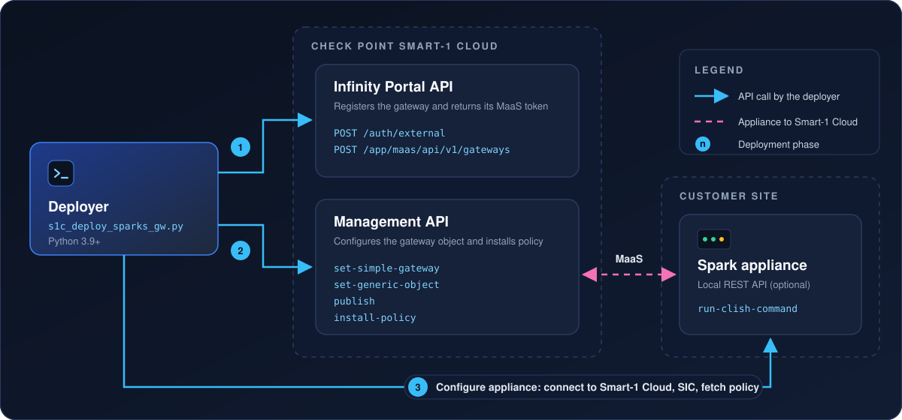
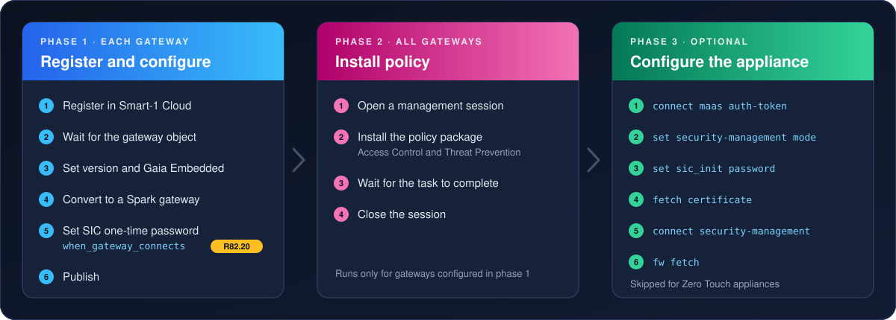
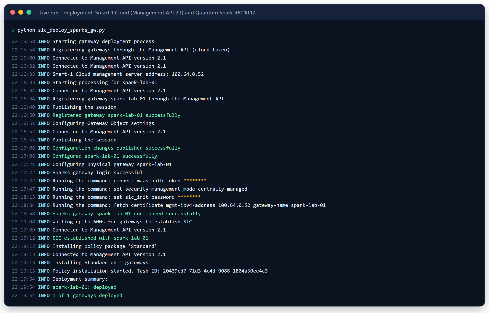
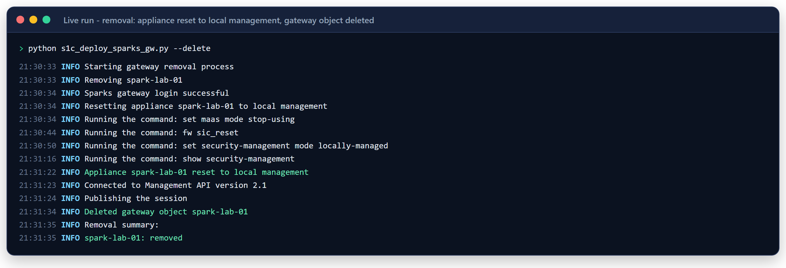
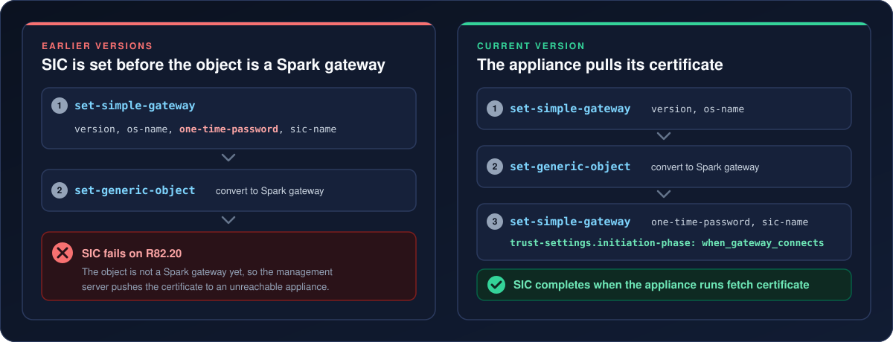

# Smart-1 Cloud Spark Gateway Deployer

Automated onboarding of Check Point Quantum Spark gateways to Smart-1 Cloud.


[Overview](#overview) · [Live Example](#live-deployment-example) · [Quick Start](#quick-start) ·
[Compatibility](#version-compatibility) · [Configuration](#configuration) ·
[Troubleshooting](#troubleshooting) · [Changelog](#changelog)

---

## Overview

The Smart-1 Cloud Spark Gateway Deployer automates the onboarding of Check Point Quantum Spark
gateways to Check Point Smart-1 Cloud. From a single set of configuration files, it registers each
gateway, configures the gateway object, installs the security policy and, optionally, configures
the appliance itself.

| Capability | Description |
|:---|:---|
| **Registration** | Registers any number of gateways in Smart-1 Cloud with only a Management API key. |
| **Object configuration** | Creates the Spark gateway object with the parameters documented in the Smart-1 Cloud Administration Guide, after checking them against the tenant, and sets the SIC trust settings. |
| **Policy installation** | Waits for each gateway to establish SIC, then installs the policy package: the Access Control policy, and the Threat Prevention policy on gateways where Threat Prevention blades are enabled. |
| **Appliance configuration** | Connects each appliance to Smart-1 Cloud over its local REST API, when its credentials are configured. |
| **Removal** | Returns the appliances to local management and deletes their gateway objects (`--delete`). |
| **Validation and logging** | Validates all configuration files before the run and keeps a rotating DEBUG log of every run. |

### Architecture

<p align="center">
  
</p>

### Workflow

<p align="center">
  
</p>

Policy is installed last, because a gateway accepts policy only after it has connected to
Smart-1 Cloud and established SIC. Phase 3 waits for each gateway to reach the "communicating"
SIC state and installs policy only on those gateways.

Phase 2 runs only for gateways whose appliance credentials (`gateway_ip`, `gateway_username`,
`gateway_password`) are configured. For other gateways the deployer registers and configures the
object but does not connect the appliance, and it does not output the cloud token. Such gateways
reach phase 3 only if their appliance is connected to Smart-1 Cloud by other means within
`sic_timeout`. This path was not tested.

A gateway that fails at any step is logged and skipped, and the run continues with the remaining
gateways. The run ends with a summary of each gateway and exits with a non-zero code if any
gateway was not deployed.

## Live Deployment Example

Console output of a real deployment against a Smart-1 Cloud tenant (Management API 2.1) and a
Quantum Spark VNF appliance running R81.10.17. Secrets are masked by the deployer. The 20-second
pauses between appliance commands are omitted.

<p align="center">
  
</p>

| Phase | Start | End | Duration |
|:---|:---:|:---:|---:|
| **1** &nbsp; Register and configure the object | `22:15:58` | `22:17:06` | 1 min 8 s |
| **2** &nbsp; Configure the appliance | `22:17:21` | `22:18:58` | 1 min 37 s |
| **3** &nbsp; Wait for SIC and install policy | `22:19:08` | `22:19:54` | 46 s |
| **Total** | | | **3 min 56 s** |

<details>
<summary><b>Configuration used for this run</b></summary>

`config/auth_data.json`:

```json
{
    "instance": "<instance>",
    "context": "<context-uuid>",
    "api_key": "<management-api-key>"
}
```

`config/config_data.json`:

```json
[
    {
        "gw_name": "spark-lab-01",
        "version": "R81.10",
        "hardware": "1800",
        "net_type": "Wired",
        "sic_key": "<one-time-password>",
        "gateway_ip": "<appliance-address>:4434",
        "gateway_username": "admin",
        "gateway_password": "<appliance-password>",
        "application_control": true,
        "url_filtering": true
    }
]
```

Application Control and URL Filtering are enabled because this tenant adds new gateways to
`Playblocks_Gateways`. See the note in [Configuration](#configuration).

`config/policy_package_data.json`:

```json
{
    "policy_package": "Standard",
    "sic_timeout": 600
}
```

</details>

**Result, verified in Smart-1 Cloud after the run:**

| Status | Check | Result |
|:---:|:---|:---|
|  | **Gateway object** | `spark-lab-01`, Gaia Embedded, R81.10, 1800 Appliances, topology `global and automatic`, IP address generated by Smart-1 Cloud |
|  | **SIC** | `test-sic-status`: `SIC Status for spark-lab-01: Communicating` |
|  | **Access Control policy** | `Standard`, installed |
|  | **Appliance access** | SSH and the web UI on port 4434 reachable after policy installation |

### Removal

The same gateway removed with `--delete`, 1 min 3 s. The 5-second pauses between appliance commands
are omitted.

<p align="center">
  
</p>

**Result, verified after the run:** no gateway objects left in Smart-1 Cloud, `Playblocks_Gateways`
empty, and on the appliance `show security-management` reports `locally-managed`, `show maas`
reports `disabled`, and `fw sic_test` reports `SIC was not initialized`.

## Quick Start

Clone the repository, install the dependencies and create your configuration files from the
templates.

**Windows (PowerShell)**

```powershell
git clone https://github.com/alshawwaf/smart1_cloud_sparks_deployer.git
cd smart1_cloud_sparks_deployer
python -m venv .venv
.venv\Scripts\activate
pip install -r requirements.txt
copy config\auth_data.example.json config\auth_data.json
copy config\config_data.example.json config\config_data.json
copy config\policy_package_data.example.json config\policy_package_data.json
```

**Linux**

```bash
git clone https://github.com/alshawwaf/smart1_cloud_sparks_deployer.git
cd smart1_cloud_sparks_deployer
python3 -m venv .venv
source .venv/bin/activate
pip install -r requirements.txt
cp config/auth_data.example.json config/auth_data.json
cp config/config_data.example.json config/config_data.json
cp config/policy_package_data.example.json config/policy_package_data.json
```

Fill in the three files as described in [Configuration](#configuration), then run the deployment:

```bash
python s1c_deploy_sparks_gw.py
```

The run ends with a summary of each gateway. See [Live Deployment Example](#live-deployment-example)
for the output of a real run.

To remove the gateways in `config_data.json` again, run:

```bash
python s1c_deploy_sparks_gw.py --delete
```

For each gateway, `--delete`:

1. Returns the appliance to local management, when its REST API credentials are configured:
   `set maas mode disable`, `fw sic_reset`, `set security-management mode locally-managed`,
   and checks the result with `show security-management`.
2. Deletes the gateway object in Smart-1 Cloud, including its membership in groups such as
   `Playblocks_Gateways`, and publishes.

If the appliance reset fails, the gateway object is still deleted and the gateway is reported as
failed in the removal summary. A gateway that no longer exists in Smart-1 Cloud is skipped, so
`--delete` can be run again safely. After `--delete`, the appliance can be deployed again from
scratch.

### Requirements

- A Check Point Smart-1 Cloud tenant on R82.20 (Management API 2.1).
- The Management API key of the tenant. In Web SmartConsole, go to **Settings > API &
  SmartConsole** and click **Generate** in the Management API section. Smart-1 Cloud supports only
  one API key.
- Python 3.9 or later on Windows or Linux.
- To configure the appliances (phase 2) and reset them with `--delete`:
  - Network access to the appliance local REST API, by default on port `4434`.
  - The REST API enabled on the appliance. It is off by default. Enable it in Gaia Clish with
    `set rest-api mode true`.

> [!WARNING]
> The deployer installs the policy package exactly as it is published. Before you run it, make
> sure the policy allows the management access you need to the appliances, for example HTTPS and
> SSH from your administration network. A cleanup rule that drops all traffic locks you out of
> the appliance local interfaces as soon as the policy is installed.

## Version Compatibility

The deployer reads the Management API version at each login and shows it in the console:

```text
INFO - Connected to Management API version 2.1
```

### Smart-1 Cloud Management

| Smart-1 Cloud | Management API | Status | Notes |
|:---:|:---:|:---:|:---|
| **R82.20** | `2.1` |  | Gateways are created with `add-simple-gateway` and `trust-method: cloud_token`. SIC uses a one-time password with `trust-settings.initiation-phase` set to `when_gateway_connects`. |
| **Earlier versions** | earlier than `2.1` |  | Management API versions earlier than 2.1 cannot issue cloud tokens. Registration fails with `Management API ... cannot issue cloud tokens`. |

> [!IMPORTANT]
> **Smart-1 Cloud R82.20 requires the current version of the deployer.**
> R82.20 added the `trust-method` and `trust-settings` parameters to `set-simple-gateway`. When a
> one-time password is set on an object that is not yet a Spark gateway, the management server
> pushes the SIC certificate immediately. Spark appliances behind Smart-1 Cloud cannot be reached
> in this way, so earlier versions of the deployer fail at the SIC step.

<p align="center">
  
</p>

### Spark Gateway Firmware

| Spark models | Minimum firmware | `version` in `config_data.json` |
|:---|:---:|:---:|
| **1500, 1600, 1800, 1900, 2000** | R81.10.X | `R81.10` or `R82` |
| **2530/2550, 2560/2570, 2580** | R82.00.05 | `R82` |
| **Quantum Edge** | R81.10.X | `R81.10` or `R82` |
| **Firmware R80.20.X and earlier** |  | Upgrade the appliance first |

Models and minimum firmware are from the [Smart-1 Cloud Administration Guide](https://sc1.checkpoint.com/documents/Infinity_Portal/WebAdminGuides/EN/Check-Point-SmartCloud-Admin-Guide/CP_Check_Point_Smart-1_Cloud_AdminGuide.pdf)
(Supported Gateways and Versions, 26 October 2026). Use `R81.10` for appliances on R81.10.X and
`R82` for appliances on R82.00.X. The deployer was tested with a Quantum Spark VNF appliance on
R81.10.17, configured as `1800 Appliances`.

> [!WARNING]
> Rugged 1200R appliances are not supported by Management Servers R82.20 (R82.20 Release Notes).

> [!TIP]
> To list the versions and hardware models that your tenant accepts, run the Management API
> command `show-gateway-capabilities` with `{"platform": "smb"}`, for example from the
> SmartConsole command line.

### Gateway Registration

Each gateway is created through the Management API, as described in the
[Smart-1 Cloud Administration Guide](https://sc1.checkpoint.com/documents/Infinity_Portal/WebAdminGuides/EN/Check-Point-SmartCloud-Admin-Guide/CP_Check_Point_Smart-1_Cloud_AdminGuide.pdf) (Example: Adding a Simple Gateway with the
Web API):

| Step | Management API command | Result |
|:---:|:---|:---|
| **1** | `show-gateway-capabilities` with `platform: smb` | `hardware`, `net_type` and `version` are checked against the values the tenant accepts, before any object is created |
| **2** | `add-simple-gateway` with `hardware` (for example `1800 Appliances`), `hardware-subtype`, `version`, `os-name: Gaia Embedded`, `trust-method: cloud_token` and `auto-generate-ip: true` | Spark gateway object with `global and automatic` topology, an IP address generated by Smart-1 Cloud, and a cloud token |
| **3** | `set-simple-gateway` with `one-time-password` and `trust-settings.initiation-phase: when_gateway_connects` | SIC waits for the appliance. The SIC name is generated by the management server. |

The one-time password is set in a separate call, because the Management API rejects
`one-time-password` together with `trust-method: cloud_token`.

In phase 2, the appliance joins Smart-1 Cloud with `connect maas auth-token <token>` and pulls its
certificate from the management server address, which the deployer reads from the
`Management_Service` object (a `100.64.x.x` address). The token is masked in the console and the
log file.

### Tested Environment

The current version was tested end to end against:

| Component | Version |
|:---|:---|
| **Smart-1 Cloud** | Management API `2.1` (R82.20) |
| **Quantum Spark** | VNF appliance `R81.10.17`, Build 521 |
| **Registration** | Management API (cloud token) |

| Status | Test | Result |
|:---:|:---|:---|
|  | **Deployment** | Gateway registered, appliance connected, SIC communicating, policy installed, appliance still reachable on SSH and its web UI |
|  | **Removal**<br>`--delete` | Appliance back to local management with SIC reset, gateway object deleted |

## Configuration

The deployer reads three JSON files from the `config` directory. The repository contains a
template for each file. Your own files are excluded by `.gitignore`, so credentials are never
committed.

```text
config/
├── auth_data.example.json             Template: Smart-1 Cloud credentials
├── config_data.example.json           Template: one entry for each gateway
├── policy_package_data.example.json   Template: policy package and timeouts
├── auth_data.json                     Your file (not tracked)
├── config_data.json                   Your file (not tracked)
└── policy_package_data.json           Your file (not tracked)
```

> [!NOTE]
> JSON does not support comments, so do not add `//` notes to the files. Keys that are not
> described below are ignored.

> [!IMPORTANT]
> **Upgrading from an earlier version:** the configuration files were previously tracked in the
> repository and are now excluded. Copy your `config` folder to a safe location before you run
> `git pull`, then copy your three files back into `config/`. If `git pull` reports local changes
> to the configuration files, run `git checkout -- config` after the backup and pull again.
> Earlier versions used Infinity Portal API keys (`client_id`, `access_key`, `portal_url`) in
> `auth_data.json`. They are no longer used and can be removed.

### `config/auth_data.json`

```json
{
    "instance": "your-instance",
    "context": "your-context-uuid",
    "api_key": "your-management-api-key"
}
```

| Key | Required | Description |
|:---|:---:|:---|
| `instance` |  | Smart-1 Cloud instance name, taken from the Management API URL `https://<instance>.maas.checkpoint.com/<context>/web_api`. Web SmartConsole shows this URL in **Settings > API & SmartConsole**. |
| `context` |  | Smart-1 Cloud context ID, taken from the same URL. |
| `api_key` |  | Management API key of the tenant, generated in Web SmartConsole in **Settings > API & SmartConsole**. |

### `config/config_data.json`

```json
[
    {
        "gw_name": "sparks1",
        "version": "R81.10",
        "hardware": "1575/1595",
        "net_type": "Wireless",
        "sic_key": "your-sic-key",
        "gateway_ip": "203.0.113.171:4434",
        "gateway_username": "admin",
        "gateway_password": "your-appliance-password"
    },
    {
        "gw_name": "sparks2",
        "version": "R82",
        "hardware": "1800",
        "net_type": "Wireless",
        "sic_key": "your-sic-key"
    }
]
```

| Key | Required | Description |
|:---|:---:|:---|
| `gw_name` |  | Gateway name, used for the Smart-1 Cloud registration and the gateway object. |
| `version` |  | Firmware family of the appliance, as accepted by the tenant: `R81.10` or `R82`. See [Spark Gateway Firmware](#spark-gateway-firmware). |
| `hardware` |  | Spark model as listed by `show-gateway-capabilities`, for example `1800 Appliances` or `1575/1595 Appliances`. The short form without "Appliances", for example `1800`, is also accepted. |
| `net_type` |  | Appliance variant, not case-sensitive: `Wired`, `Wireless`, `DSL`, `Wireless + DSL` or `WiFi-LTE`, as listed by `show-gateway-capabilities`. |
| `sic_key` |  | One-time password used to establish SIC. |
| `gateway_ip` |  | Address and port of the appliance local REST API, for example `203.0.113.171:4434`. |
| `gateway_username` |  | Administrator user name on the appliance. |
| `gateway_password` |  | Administrator password on the appliance. |
| `application_control` |  | Enable the Application Control blade. Default `false`. |
| `url_filtering` |  | Enable the URL Filtering blade. Default `false`. |

> [!NOTE]
> In the test tenant, which uses Playblocks, new gateways were added to the `Playblocks_Gateways`
> group shortly after they were deployed. The Quarantine Policy rules for that group require
> Application Control and URL Filtering. If this happens in your tenant, set both to `true` for
> those gateways, otherwise later policy installations fail with *"Rule 2 contains applications ... that require the 'Application
> Control' or the 'URL Filtering' blades"*.

To have the deployer configure the appliance in phase 2 and reset it with `--delete`, provide all
three of `gateway_ip`, `gateway_username` and `gateway_password`. See [Workflow](#workflow) for
gateways without them.

### `config/policy_package_data.json`

```json
{
    "policy_package": "Standard",
    "install_delay": 30,
    "sic_timeout": 600
}
```

| Key | Required | Description |
|:---|:---:|:---|
| `policy_package` |  | Name of the policy package to install on the gateways. |
| `sic_timeout` |  | Seconds to wait for gateways to establish SIC before policy installation. Default `600`. |
| `install_delay` |  | Reserved. Not used by the current version of the deployer. |

## Logging

| Output | Level | Content |
|:---|:---:|:---|
| **Console** | `INFO` | Progress of each phase and gateway. |
| **`logs/s1c_deploy_sparks_gw.log`** | `DEBUG` | Full details, including API responses. Rotated at 5 MB, with 3 backups. |

MaaS tokens, SIC one-time passwords and appliance passwords are replaced with `********` in the
console and in the log file.

**Resilience**

- All configuration files are validated before the deployment starts.
- Clish output from the appliance is checked, so a rejected command fails that gateway instead of
  being reported as successful.
- SIC is confirmed with `test-sic-status`, which actively tests the connection.
- The `hardware`, `net_type` and `version` of each gateway are checked against the tenant before
  any object is created. A gateway with an unsupported value fails with a list of the accepted
  values.
- Every HTTP request has a 60-second timeout, and publish and policy installation tasks have a
  30-minute limit, so a stalled connection cannot stop the run indefinitely.
- Each phase opens and closes its own Management API session.

## Troubleshooting

Expand an entry for its cause and resolution.

<details>
<summary>SIC errors on <code>set-simple-gateway</code>, or the gateway does not reach the "communicating" state, after the upgrade to R82.20</summary>

**Cause:** Earlier versions of the deployer set the one-time password before the object was a Spark gateway

**Resolution:** Update to the current version and confirm that the log shows `Management API version 2.1`.

</details>

<details>
<summary><code>Policy installation failed</code> with a session error</summary>

**Cause:** Earlier versions of the deployer used a closed Management API session

**Resolution:** Update to the current version.

</details>

<details>
<summary><code>SIC not established with ... skipping policy installation</code></summary>

**Cause:** The appliance did not connect to Smart-1 Cloud within `sic_timeout`

**Resolution:** Check the appliance connectivity and the phase 2 log entries. If the appliance needs more time, increase `sic_timeout`, or install policy from SmartConsole once the gateway connects.

</details>

<details>
<summary><code>Config file ... not found</code></summary>

**Cause:** The configuration file has not been created

**Resolution:** Copy the matching `.example.json` template in `config/` and fill in your values.

</details>

<details>
<summary><code>REST API on this appliance is off</code></summary>

**Cause:** The appliance local REST API is disabled (default)

**Resolution:** On the appliance, run `set rest-api mode true` in Gaia Clish.

</details>

<details>
<summary><code>Command '...' failed: ...</code> in phase 2</summary>

**Cause:** The appliance rejected a Clish command. The message contains the appliance output.

**Resolution:** For `A trusted communication certificate already exists` or `You must reinitialize trusted communications`, the appliance has SIC from an earlier connection. Run `python s1c_deploy_sparks_gw.py --delete`, then deploy again.

</details>

<details>
<summary><code>Security Gateway and Security Management policy versions are incompatible</code></summary>

**Cause:** The policy was unloaded or changed locally on the appliance after an installation, so the accelerated policy installation no longer matches

**Resolution:** Run `--delete` and deploy again, or disable Accelerated Install Policy for the gateway in SmartConsole (sk168055).

</details>

<details>
<summary>Access to the appliance is lost after policy installation, and the logs show <code>WebUI/SSH access attempt from unallowed source</code></summary>

**Cause:** Earlier versions of the deployer left the gateway object with `per interface` topology and no interfaces

**Resolution:** Update to the current version. It creates Spark gateways with the documented `add-simple-gateway` parameters, which give them `global and automatic` topology. For an existing gateway, set the topology to `global and automatic` in SmartConsole and install policy.

</details>

<details>
<summary>Access to the appliance is lost after policy installation, and the logs show a policy rule</summary>

**Cause:** The installed policy drops management traffic

**Resolution:** Unload the policy from the appliance console, allow management access in the policy, publish, and redeploy.

</details>

<details>
<summary>Policy installation fails with <code>... require the 'Application Control' or the 'URL Filtering' blades</code></summary>

**Cause:** The gateway was added to a group whose rules need those blades, such as `Playblocks_Gateways`

**Resolution:** Set `application_control` and `url_filtering` to `true` for the gateway and redeploy, or enable the blades in SmartConsole.

</details>

<details>
<summary><code>hardware '...' is not supported</code>, <code>net_type '...' is not supported</code> or <code>version '...' is not supported</code></summary>

**Cause:** The value in `config_data.json` is not one that the tenant accepts for Spark gateways

**Resolution:** Use one of the values listed in the error message. They come from `show-gateway-capabilities`.

</details>

<details>
<summary><code>Management API ... cannot issue cloud tokens</code></summary>

**Cause:** The Smart-1 Cloud tenant is not on R82.20 (Management API 2.1)

**Resolution:** Gateway registration requires Smart-1 Cloud R82.20. See [Version Compatibility](#version-compatibility).

</details>

<details>
<summary><code>Management server upgrade in progress</code> warning</summary>

**Cause:** Smart-1 Cloud is running a background upgrade

**Resolution:** Wait for the upgrade to complete, then run the deployment.

</details>

<details>
<summary>The appliance runs firmware earlier than R81.10.X, or is a Rugged 1200R appliance</summary>

**Cause:** Smart-1 Cloud R82.20 does not support these appliances

**Resolution:** See [Version Compatibility](#version-compatibility).

</details>

For full details of a run, see `logs/s1c_deploy_sparks_gw.log`.

## Security

> [!CAUTION]
> The configuration files contain credentials. They are excluded by `.gitignore`; do not force-add
> them to version control.

- Secrets are masked in the console and the log file. Treat the log file as sensitive anyway,
  because it contains API responses.
- The local REST API client does not verify the appliance certificate. Run phase 2 only on
  trusted management networks.
- Smart-1 Cloud supports only one Management API key, and the deployer uses it. Protect it like an
  administrator password.

## References

The deployer and this README were checked against these documents:

| Resource | Edition | Used for |
|:---|:---|:---|
| **[Smart-1 Cloud Administration Guide](https://sc1.checkpoint.com/documents/Infinity_Portal/WebAdminGuides/EN/Check-Point-SmartCloud-Admin-Guide/CP_Check_Point_Smart-1_Cloud_AdminGuide.pdf)** | 26 October 2026 | Adding a Spark gateway with the Web API, cloud token, supported Spark models and versions, MaaS commands, API key |
| **[Quantum Spark R81.10.X CLI Reference Guide](https://sc1.checkpoint.com/documents/SMB_R81.10.X/CLI/EN/CP_R81.10.X_1500_1600_1800_1900_2000_Appliances_CLI_Guide.pdf)** | 5 October 2026 | `connect maas`, `set maas mode`, `set security-management mode`, `set sic_init`, `fetch certificate`, `fw sic_reset`, `set rest-api` |
| **[Quantum Spark R82.00.X Centrally Managed Administration Guide](https://sc1.checkpoint.com/documents/Appliances/Quantum_Spark_R82.00.X/AdminGuides_Centrally_Managed/EN/CP_R82.00.X_Quantum_Spark_Appliances_Centrally_Managed_AdminGuide.pdf)** | 22 September 2026 | Smart-1 Cloud onboarding of R82.00.X appliances |
| **[Check Point Management API Reference](https://sc1.checkpoint.com/documents/latest/APIs/)** | v2.1 | `add-simple-gateway`, `set-simple-gateway` (including `trust-settings`), `show-gateway-capabilities`, `test-sic-status`, `delete-simple-gateway`, `install-policy` |
| **[R82.20 Release Notes](https://sc1.checkpoint.com/documents/R82.20/WebAdminGuides/EN/CP_R82.20_RN/CP_R82.20_ReleaseNotes.pdf)** | R82.20 | Supported Spark versions, Rugged 1200R |

## Changelog

### November 2026: Documented Spark API, Infinity Portal registration removed

Verified again end to end in the lab (deploy and `--delete`).

- Spark gateways are created with one `add-simple-gateway` call, using the parameters from the
  Smart-1 Cloud Administration Guide (`hardware`, `hardware-subtype`, `version`,
  `trust-method: cloud_token`, `auto-generate-ip`). The undocumented `set-generic-object`
  conversion, the explicit topology setting and the SIC name built by the deployer are no longer
  needed.
- `hardware`, `net_type` and `version` are checked against `show-gateway-capabilities` before any
  object is created.
- The management server address for `fetch certificate` is read from the `Management_Service`
  object instead of using a fixed `100.64.0.52`.
- `--delete` uses `set maas mode disable`, the command documented to stop Smart-1 Cloud management.
- Gateways are registered only through the Management API. The Infinity Portal API registration and
  its `client_id`, `access_key` and `portal_url` keys were removed, together with
  `utils/smart1_cloud_api.py`. The deployer now requires Smart-1 Cloud R82.20.

### November 2026: Spark topology fix and `--delete`

Verified with repeated deploy and delete cycles against the lab.

- Spark gateway objects get `interfaces-topology-settings: global and automatic`. Before, they kept
  `per interface` topology with no interfaces. Policy installation then warned about missing
  topology, and the appliance dropped local WebUI and SSH access ("access attempt from unallowed
  source") after every policy installation.
- New `--delete` mode: returns each appliance to local management and deletes its gateway object.
- New optional `application_control` and `url_filtering` settings for each gateway, for groups
  such as `Playblocks_Gateways` whose rules need those blades.

### November 2026: Lab-verified, registration without Infinity Portal keys

Verified end to end against Smart-1 Cloud (Management API 2.1) and a Quantum Spark R81.10.17
appliance.

- Gateways can be registered with only a Management API key (`add-simple-gateway` with
  `auto-generate-ip`, then `set-trust` with `cloud_token`). The Infinity Portal API credentials are
  now optional.
- SIC is confirmed with `test-sic-status`. The `sic-state` field of the gateway object stays
  `waiting_for_first_connection` after the appliance pulls its certificate, so it cannot be used.
- `connect security-management ... use-one-time-password true` was removed from appliance
  configuration. After `fetch certificate` it always fails with "You must reinitialize trusted
  communications", and the MaaS connection and certificate pull already complete the setup.
- Clish output is checked for errors, so a rejected appliance command is reported as a failure.

### November 2026: Deployment order and security

- Policy is now installed last. The appliance is configured first, then the deployer waits for
  each gateway to establish SIC (`sic_timeout`) and installs policy only on those gateways.
  Previously, policy installation ran before the appliance was connected and stopped the run
  when it failed.
- A failure no longer stops the run. Each gateway is reported in a summary, and the deployer exits
  with a non-zero code if any gateway was not deployed.
- The `fw fetch` command was removed from appliance configuration, because policy is installed
  from the management server.
- MaaS tokens, SIC one-time passwords and appliance passwords are masked in the console and the
  log file.
- All HTTP requests have a timeout, and publish and policy installation tasks have a time limit.
- The configuration files are no longer tracked. The repository now contains `.example.json`
  templates. See the upgrade note in [Configuration](#configuration).

### November 2026: Smart-1 Cloud R82.20 support

- SIC is configured after the gateway object is converted to a Spark gateway. On R82.20
  (Management API 2.1), the deployer also sets `trust-settings.initiation-phase` to
  `when_gateway_connects`, so the appliance pulls its certificate.
- Policy installation opens its own Management API session, and the logout request is sent
  correctly.
- The deployer waits for Smart-1 Cloud to create the gateway object instead of relying only on a
  fixed delay.
- The management SIC name is parsed regardless of field order or case.
- Policy installation is skipped when no gateway was configured.
- A task that partially succeeds is reported as a failure.
- Fixed `delete_gateway()` in `utils/smart1_cloud_api.py`.
- Console and log messages no longer contain emojis.
