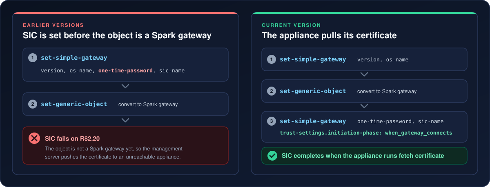

# Version Compatibility

[Back to the README](../README.MD)

The deployer reads the Management API version at each login and shows it in the console:

```text
INFO - Connected to Management API version 2.2
```

## Smart-1 Cloud Management

| Smart-1 Cloud | Management API | Status | Notes |
|:---:|:---:|:---:|:---|
| **R82.20** | `2.1`, `2.2` |  | Gateways are created with `add-simple-gateway` and `trust-method: cloud_token`. SIC uses a one-time password with `trust-settings.initiation-phase` set to `when_gateway_connects`. |
| **Earlier versions** | earlier than `2.1` |  | Management API versions earlier than 2.1 cannot issue cloud tokens. Registration fails with `Management API ... cannot issue cloud tokens`. |

> [!IMPORTANT]
> **Smart-1 Cloud R82.20 requires the current version of the deployer.**
> R82.20 added the `trust-method` and `trust-settings` parameters to `set-simple-gateway`. When a
> one-time password is set on an object that is not yet a Spark gateway, the management server
> pushes the SIC certificate immediately. Spark appliances behind Smart-1 Cloud cannot be reached
> in this way, so earlier versions of the deployer fail at the SIC step.

<p align="center">
  
</p>

## Spark Gateway Firmware

| Spark models | Minimum firmware | `version` in `config_data.json` |
|:---|:---:|:---:|
| **1500, 1600, 1800, 1900, 2000** | R81.10.X | `R81.10` or `R82` |
| **2530/2550, 2560/2570, 2580** | R82.00.05 | `R82` |
| **Quantum Edge** | R81.10.X | `R81.10` or `R82` |
| **Firmware R80.20.X and earlier** |  | Upgrade the appliance first |

Models and minimum firmware are from the [Smart-1 Cloud Administration Guide](https://sc1.checkpoint.com/documents/Infinity_Portal/WebAdminGuides/EN/Check-Point-SmartCloud-Admin-Guide/CP_Check_Point_Smart-1_Cloud_AdminGuide.pdf)
(Supported Gateways and Versions, 26 October 2026). Use `R81.10` for appliances on R81.10.X and
`R82` for appliances on R82.00.X. The deployer was tested with a Quantum Spark VNF appliance on
R81.10.17, configured as `1800 Appliances`.

> [!WARNING]
> Rugged 1200R appliances are not supported by Management Servers R82.20 (R82.20 Release Notes).

> [!TIP]
> To list the versions and hardware models that your tenant accepts, run the Management API
> command `show-gateway-capabilities` with `{"platform": "smb"}`, for example from the
> SmartConsole command line.

## net_type values by model

`show-gateway-capabilities` lists the subtypes of all Spark models together, but each model
accepts only some of them. These are the combinations that Smart-1 Cloud R82.20 accepted when
tested with `add-simple-gateway` in November 2026:

| `hardware` | `version` | Accepted `net_type` |
|:---|:---:|:---|
| **1530/1550**, **1535/1555** | `R81.10`, `R82` | `Wired`, `Wireless` |
| **1570/1590**, **1575/1595** | `R81.10`, `R82` | `Wired`, `Wireless`, `Wireless + DSL`, `WiFi-LTE` |
| **1600**, **1800**, **1900/2000** | `R81.10`, `R82` | `Wired` |
| **2530/2550**, **2560/2570** | `R82` | `Wired`, `WiFi-LTE` |
| **2580**, **2590** | `R82` | `Wired` |

> [!IMPORTANT]
> The 2530/2550 and 2560/2570 Wi-Fi models are registered as `WiFi-LTE`. `Wireless` is rejected
> for these models with *"Hardware/hardware-subtype value is not valid or doesn't match specified
> platform"*. `DSL` on its own was not accepted for any model.

## Tested Environment

The current version was tested end to end against:

| Component | Version |
|:---|:---|
| **Smart-1 Cloud** | R82.20, Management API `2.1` and `2.2` |
| **Quantum Spark** | VNF appliance `R81.10.17`, Build 521 |
| **Registration** | Management API (cloud token) |
| **Blades** | Firewall, IPsec VPN, IPS, Anti-Bot, Anti-Virus, Application Control, URL Filtering |
| **Last tested** | 17 November 2026, deployer version `2026.11.17` |

| Status | Test | Result |
|:---:|:---|:---|
|  | **Deployment** | Gateway registered, appliance connected, SIC communicating, policy installed, appliance still reachable on SSH and its web UI |
|  | **Blades and policy** | All six optional blades enabled on the object. Access Control policy installed, then Threat Prevention policy installed in a second request, without a retry |
|  | **Interfaces and topology** | `WAN 203.0.113.212/24` external and `LAN1 192.168.212.1/24` internal on the object after deployment with all six blades. Appliance still reachable for administration |
|  | **Manual onboarding** | Gateway without appliance credentials registered, token file saved, no SIC wait |
|  | **Removal**<br>`--delete` | Appliance back to local management with SIC reset, gateway object deleted |

Not tested on an appliance: the *REST API is off* message (the lab appliance has the REST API
enabled), and the login retry in `--delete` (the connection did not drop long enough to need it).
