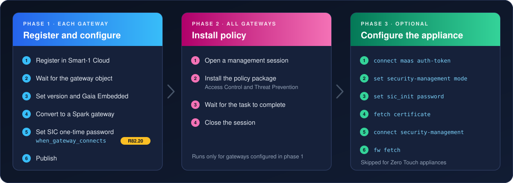

# How the Deployer Works

[Back to the README](../README.MD)

[Workflow](#workflow) · [Gateway Registration](#gateway-registration) · [Interfaces and Topology](#interfaces-and-topology) · [Resilience](#resilience)

## Workflow

  

Policy is installed last, because a gateway accepts policy only after it has connected to
Smart-1 Cloud and established SIC. Phase 3 waits for each gateway to reach the "communicating"
SIC state and installs policy only on those gateways. The Access Control policy is installed
first and the Threat Prevention policy in a second request, because a newly connected gateway
rejects the Threat Prevention policy when both are sent together.

Before the policy is installed, the deployer sets the interfaces of each gateway object. It reads
them from the appliance in phase 2 (`show interfaces table` and `show internet-connections table`)
and sets them on the object once SIC is established: Internet connections as external interfaces,
all other interfaces with an IP address as internal, with Anti-Spoofing on. For gateways with
Threat Prevention blades it sets them again after the Threat Prevention policy and installs the
Access Control policy once more. See
[Interfaces and topology](#interfaces-and-topology).

Phase 2 runs only for gateways whose appliance credentials (`gateway_ip`, `gateway_username`,
`gateway_password`) are configured. For a gateway without them, the deployer registers and
configures the object, then saves the cloud token and the onboarding steps to
`tokens/<gw_name>.txt` (see [Manual Onboarding](../README.MD#manual-onboarding)). These gateways are not part
of phases 2 and 3: connect the appliance with the steps in the file, then install the policy from
SmartConsole.

If phase 2 fails for a gateway, for example because the appliance REST API is off or cannot be
reached, the deployer saves the same `tokens/<gw_name>.txt` file for it and does not wait for SIC
with that gateway. The gateway is reported as failed, and the appliance can still be connected
with the steps in the file.

A gateway that fails at any step is logged and skipped, and the run continues with the remaining
gateways. The run ends with a summary of each gateway and exits with a non-zero code if any
gateway was not deployed.

## Gateway Registration

Each gateway is created through the Management API, as described in the
[Smart-1 Cloud Administration Guide](https://sc1.checkpoint.com/documents/Infinity_Portal/WebAdminGuides/EN/Check-Point-SmartCloud-Admin-Guide/CP_Check_Point_Smart-1_Cloud_AdminGuide.pdf) (Example: Adding a Simple Gateway with the
Web API):

| Step | Management API command | Result |
|:---:|:---|:---|
| **1** | `show-gateway-capabilities` with `platform: smb` | `hardware`, `net_type` and `version` are checked against the values the tenant accepts, before any object is created |
| **2** | `add-simple-gateway` with `hardware` (for example `1800 Appliances`), `hardware-subtype`, `version`, `os-name: Gaia Embedded`, `trust-method: cloud_token` and `auto-generate-ip: true` | Spark gateway object with `global and automatic` topology, an IP address generated by Smart-1 Cloud, and a cloud token |
| **3** | `set-simple-gateway` with `one-time-password` and `trust-settings.initiation-phase: when_gateway_connects` | SIC waits for the appliance. The SIC name is generated by the management server. |

The one-time password is set in a separate call, because the Management API rejects
`one-time-password` together with `trust-method: cloud_token`.

In phase 2, the appliance joins Smart-1 Cloud with `connect maas auth-token <token>` and pulls its
certificate from the management server address, which the deployer reads from the
`Management_Service` object (a `100.64.x.x` address). The token is masked in the console and the
log file.

## Interfaces and Topology

A new Spark gateway object has `global and automatic` topology and only placeholder interfaces
without addresses (`WAN`, `LAN Switch`, `DMZ`). The Management API command `get-interfaces` does not work for Spark gateways (`Failed to get
interfaces`), so the deployer reads the interfaces from the appliance and sets them itself:

| Step | Where | Result |
|:---:|:---|:---|
| **1** | Appliance, `show internet-connections table` | Each Internet connection with an IPv4 address becomes an **external** interface, named after its interface, for example `WAN` |
| **2** | Appliance, `show interfaces table` | Each other interface with an IPv4 address becomes an **internal** interface, for example `LAN1`. Interfaces without an address are left out |
| **3** | Management API, `set-simple-gateway` with `interfaces-topology-settings: per interface` and `interfaces` | The interfaces are on the object, with Anti-Spoofing on (Prevent) |

- Step 3 runs after SIC is established and before the Access Control policy is installed.
- The first Threat Prevention installation on a Spark gateway empties the interface list of its
  object and leaves it in `per interface` mode (observed on R81.10.17 with Smart-1 Cloud R82.20).
  For gateways with IPS, Anti-Bot or Anti-Virus the deployer therefore repeats step 3 after the
  Threat Prevention installation and installs the Access Control policy once more. Later
  installations keep the list.
- The network behind an internal interface is the network of its own IP address and mask, the
  only choice the API accepts for Spark gateways. If other networks are routed behind an internal
  interface, add them to that interface in SmartConsole, or Anti-Spoofing drops their traffic.
- An interface named `DMZ` is marked as leading to a DMZ.
- If the interfaces cannot be read or set, the deployer logs a warning, the object keeps its
  `global and automatic` topology, and the deployment continues.
- Gateways without appliance credentials ([Manual Onboarding](../README.MD#manual-onboarding)) keep
  `global and automatic` topology. Set their interfaces in SmartConsole.

## Resilience

- All configuration files are validated before the deployment starts.
- Clish output from the appliance is checked, so a rejected command fails that gateway instead of
  being reported as successful.
- SIC is confirmed with `test-sic-status`, which actively tests the connection.
- The `hardware`, `net_type` and `version` of each gateway are checked against the tenant before
  any object is created. A gateway with an unsupported value fails with a list of the accepted
  values.
- Every HTTP request has a 60-second timeout, and publish and policy installation tasks have a
  30-minute limit, so a stalled connection cannot stop the run indefinitely.
- Each phase opens and closes its own Management API session.
- The Access Control policy and the Threat Prevention policy are installed in separate requests,
  and a failed Threat Prevention installation is repeated once.
- A gateway whose appliance cannot be configured keeps its object and gets a token file, and the
  run does not wait for SIC with it.
- The interfaces of the object are set before the Access Control policy is installed, and again
  after the first Threat Prevention installation, which empties them. A failure to set them is a
  warning, not a failed deployment.
- A task status request that gets no answer is repeated, so one timeout of a busy management
  server does not fail a publish or a policy installation.
