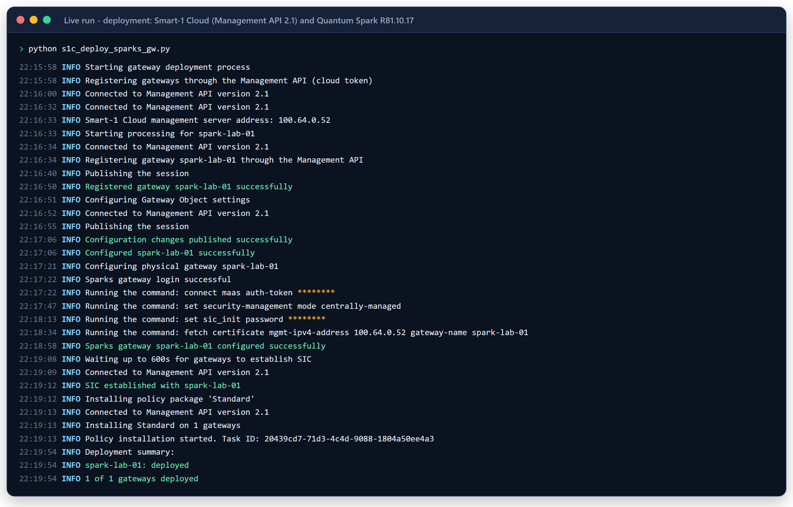
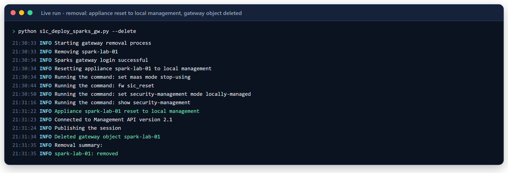

# Live Deployment Example

[Back to the README](../README.MD)

Console output of a real deployment against a Smart-1 Cloud tenant (Management API 2.1) and a
Quantum Spark VNF appliance running R81.10.17. Secrets are masked by the deployer. The 20-second
pauses between appliance commands are omitted.

<p align="center">
  
</p>

| Phase | Start | End | Duration |
|:---|:---:|:---:|---:|
| **1** &nbsp; Register and configure the object | `22:15:58` | `22:17:06` | 1 min 8 s |
| **2** &nbsp; Configure the appliance | `22:17:21` | `22:18:58` | 1 min 37 s |
| **3** &nbsp; Wait for SIC and install policy | `22:19:08` | `22:19:54` | 46 s |
| **Total** | | | **3 min 56 s** |

<details>
<summary><b>Configuration used for this run</b></summary>

`config/auth_data.json`:

```json
{
    "instance": "<instance>",
    "context": "<context-uuid>",
    "api_key": "<management-api-key>"
}
```

`config/config_data.json`:

```json
[
    {
        "gw_name": "spark-lab-01",
        "version": "R81.10",
        "hardware": "1800",
        "net_type": "Wired",
        "sic_key": "<one-time-password>",
        "gateway_ip": "<appliance-address>:4434",
        "gateway_username": "admin",
        "gateway_password": "<appliance-password>",
        "application_control": true,
        "url_filtering": true
    }
]
```

Application Control and URL Filtering are enabled because this tenant adds new gateways to
`Playblocks_Gateways`. See the note in [Configuration](../README.MD#configuration).

`config/policy_package_data.json`:

```json
{
    "policy_package": "Standard",
    "sic_timeout": 600
}
```

</details>

**Result, verified in Smart-1 Cloud after the run:**

| Status | Check | Result |
|:---:|:---|:---|
|  | **Gateway object** | `spark-lab-01`, Gaia Embedded, R81.10, 1800 Appliances, interfaces `WAN` (external) and `LAN1` (internal) read from the appliance, IP address generated by Smart-1 Cloud |
|  | **SIC** | `test-sic-status`: `SIC Status for spark-lab-01: Communicating` |
|  | **Access Control policy** | `Standard`, installed |
|  | **Appliance access** | SSH and the web UI on port 4434 reachable after policy installation |

## Removal

The same gateway removed with `--delete`, 1 min 3 s. The 5-second pauses between appliance commands
are omitted.

<p align="center">
  
</p>

**Result, verified after the run:** no gateway objects left in Smart-1 Cloud, `Playblocks_Gateways`
empty, and on the appliance `show security-management` reports `locally-managed`, `show maas`
reports `disabled`, and `fw sic_test` reports `SIC was not initialized`.
